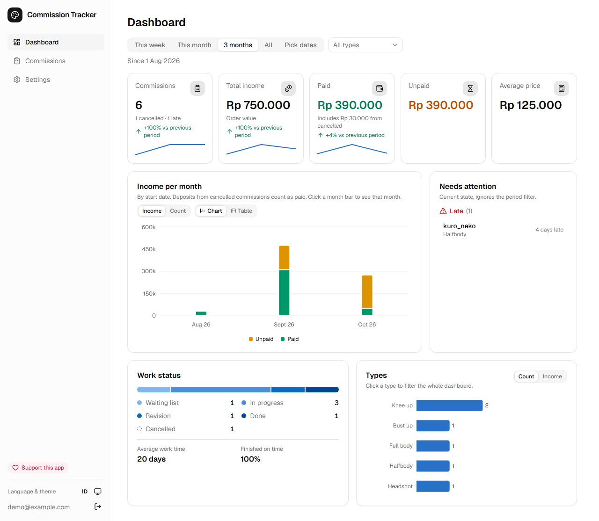
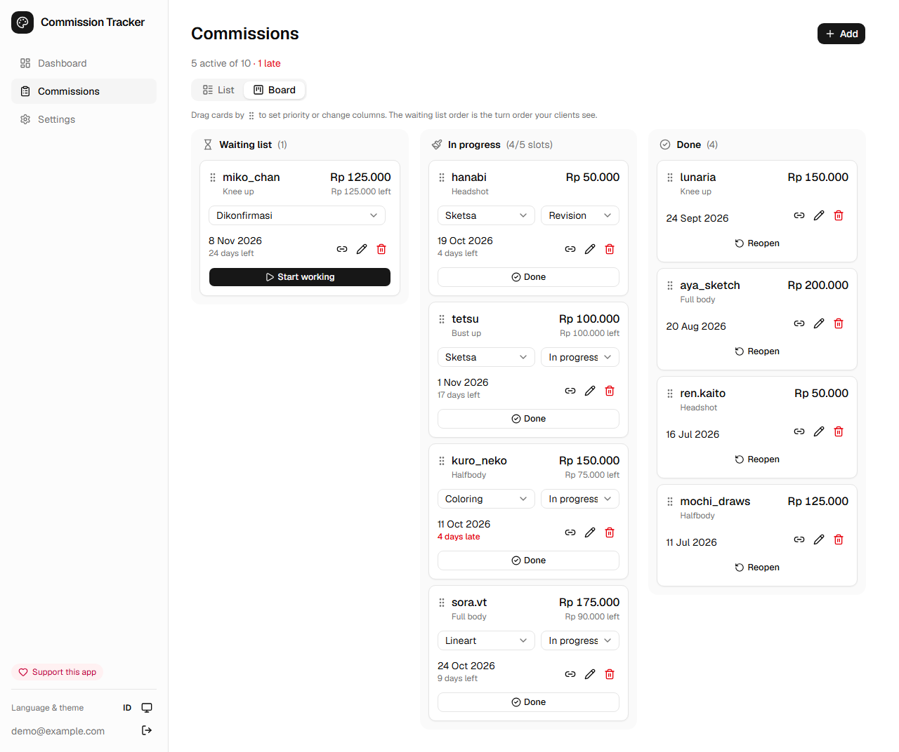
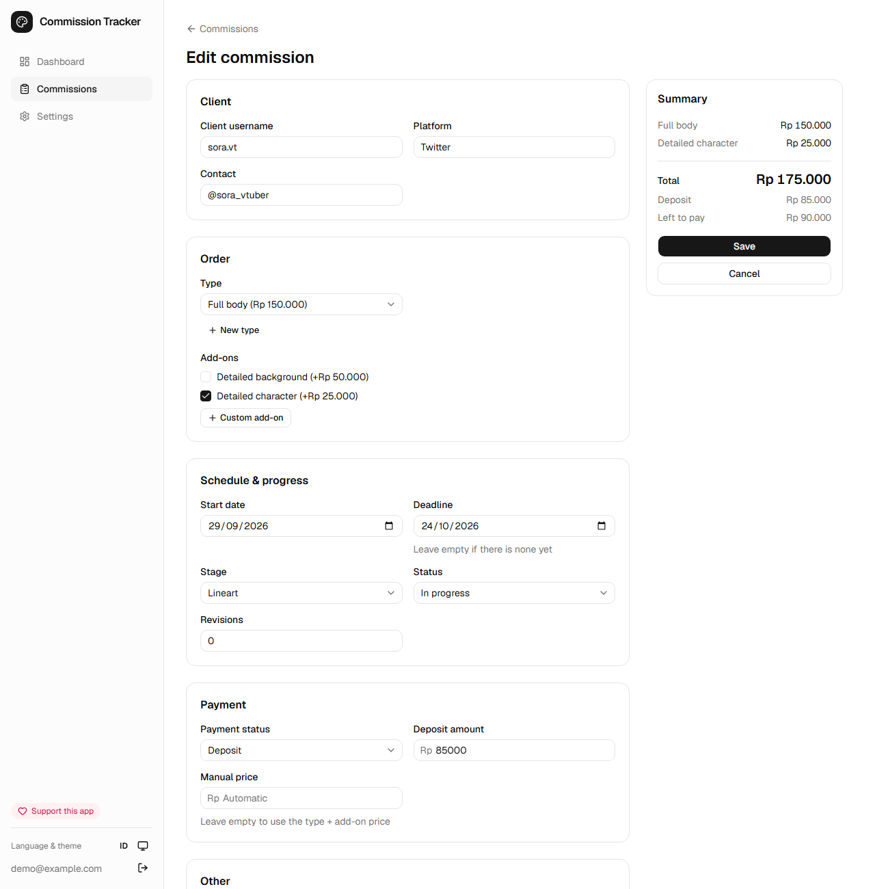
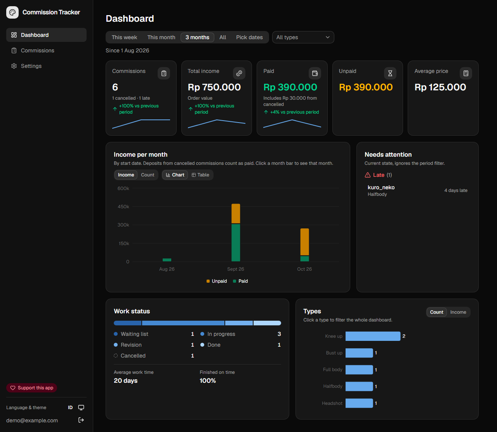
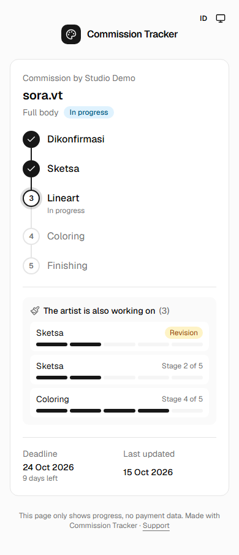
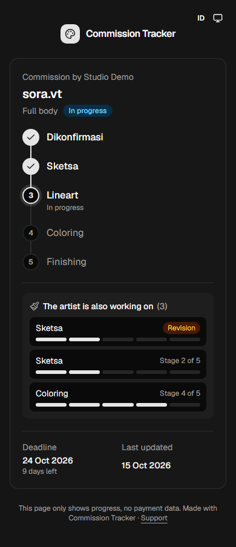

# Commission Tracker

A free web app for illustrators who take art commissions. Track every order from waiting list to delivery, see what you earned and what clients still owe, and send each client a private link where they can follow their commission's progress.

**Live:** https://commission-tracker-one.vercel.app
**Example client tracking page:** https://commission-tracker-one.vercel.app/track/3d8e7808 (fictional demo data)



## Features

**For the artist**
- Commission list and a drag-and-drop board (Waiting list → In progress → Done) that works with mouse, touch, and keyboard.
- Price per order type plus add-ons, with a manual price override. Edits keep the price the client was quoted.
- Payment status per commission (unpaid, deposit, paid) and the amount still owed.
- Your own workflow stages (e.g. Sketch → Lineart → Coloring) and a slot limit. New orders go to the waiting list when your slots are full.
- WIP images per commission, compressed in the browser and deleted 30 days after the commission is done.
- Dashboard: income vs unpaid per day or month, comparison with the previous period, a "needs attention" list (late, due soon, done but unpaid), work pipeline, average work time, on-time rate, and income per order type. Click a month to zoom in, or a type to filter the whole dashboard. Every chart has a table view.

**For the client**
- A private tracking link per commission: current stage, place in the waiting list, what the artist is working on (without other clients' names), and an estimated finish date based on the artist's pace. No prices or contact details.

**Everywhere**
- A public landing page, a privacy page, and self-service account deletion (data and images).
- Indonesian and English, switchable on every page, including the client tracking page.
- Light, dark, or system theme.
- Works on phones and desktops.

| Board | Commission form |
|---|---|
|  |  |

| Dashboard, dark | Client tracking | Client tracking, dark |
|---|---|---|
|  |  |  |

## Stack

Next.js 16 (App Router, Cache Components), React 19, TypeScript, Tailwind CSS 4, shadcn/ui, TanStack Table, Recharts, dnd-kit, React Hook Form + Zod, Supabase (Postgres, Auth, Storage), Vitest. Hosted on Vercel.

## How it works

- **Security lives in the database.** Every table has row-level security (`user_id = auth.uid()`). The client tracking page reads one commission through the `get_tracking(code)` Postgres function, which returns progress only. The anonymous role has no access to any table.
- **Prices are computed in one place.** `lib/pricing.ts` holds the price rules and `lib/stats.ts` the dashboard math. Both have unit tests. Money is stored as integer rupiah.
- **One Zod schema per form**, shared by the browser and the server action.
- **Language without URL prefixes.** Routes live under `app/[lang]`. `proxy.ts` rewrites `/dashboard` to `/en/dashboard` or `/id/dashboard` from a `lang` cookie, so links stay short and old tracking links keep working. Both languages prerender.
- **Storage cleanup.** A Vercel Cron job (`/api/cron/cleanup-wip`, protected by `CRON_SECRET`) removes WIP images 30 days after a commission is done.

Details: [`plan.md`](plan.md) (scope and milestones), [`database.md`](database.md) (schema and rules), [`docs/case-study.md`](docs/case-study.md) (problem, decisions, results).

## Run it locally

You need Node.js 20.9 or newer and a Supabase project.

```bash
git clone https://github.com/ariefusry/Commission-Tracker.git
cd Commission-Tracker
npm install
cp .env.example .env.local   # then fill it in
```

| Variable | Where to find it |
|---|---|
| `NEXT_PUBLIC_SUPABASE_URL` | Supabase → Project Settings → API |
| `NEXT_PUBLIC_SUPABASE_PUBLISHABLE_KEY` | Supabase → Project Settings → API keys |
| `SUPABASE_SECRET_KEY` | Supabase → API keys (server only, used by the cleanup cron) |
| `SUPABASE_DB_URL` | Supabase → Connect → connection string (for migrations) |
| `CRON_SECRET` | Any long random string |

Apply the database migrations, then start the app:

```bash
npx supabase db push --db-url "$SUPABASE_DB_URL"
npm run dev
```

Open http://localhost:3000 and sign up. New accounts get default order types, add-ons, and stages.

**Optional demo data:** sign up as `demo@example.com`, then run `supabase/demo/seed.sql` against your database (for example with `psql "$SUPABASE_DB_URL" -f supabase/demo/seed.sql`). It adds fictional commissions with dates relative to today.

### Auth emails

`supabase/templates/` holds bilingual (Indonesian + English) emails for sign-up confirmation and password reset. Paste each file into Supabase → Authentication → Emails, with the subject line written at the top of the file. In Authentication → URL Configuration, set the Site URL to your deployed URL and add `<your-url>/auth/confirm` to the redirect URLs.

### Checks

```bash
npm run lint
npm test            # unit tests: pricing, stats, queue estimate, dates, formatting
npm run build
```

SQL tests for RLS, saving, tracking, queue, WIP images, and account deletion are in `supabase/tests/`. Each one runs inside a transaction and rolls back.

## Deploy

Import the repo in Vercel, add the five environment variables above, and deploy. `vercel.json` registers the daily cleanup cron.

## Support

The app is free. If it helps you, you can [support it with a QRIS donation](https://commission-tracker-one.vercel.app/donasi).
